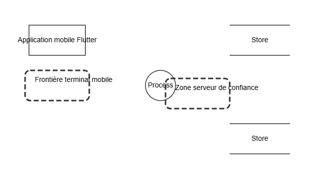

# RAPPORT FINAL : Examen DevSecOps
# Rezo

**Étudiant(e) :** À compléter  
**Matricule :** À compléter  
**Date :** 31 août 2026  
**Repo GitHub :** https://github.com/ndiougand20-commits/rezo-devsecops  
**Stack technique :** Flutter/Dart, Java, Spring Boot, Spring Security, JWT, PostgreSQL, Docker

---

## Résumé Exécutif

Rezo est une application mobile Flutter connectée à une API Spring Boot et PostgreSQL. La modélisation STRIDE recense huit menaces couvrant les six catégories, dont l'usurpation de session, l'élévation de privilèges et la divulgation de profils. La revue OWASP manuelle a identifié sept faiblesses. Sept règles Semgrep personnalisées ont initialement produit sept occurrences. Six corrections ont ensuite protégé les fonctions administratives, Swagger, les communications mobiles, les uploads PDF et les refresh tokens. Le scan Semgrep après correction ne produit plus aucune alerte custom et les 119 tests backend passent. La pipeline GitHub Actions automatise GitLeaks, Semgrep, Snyk, Trivy, le build Docker et l'envoi SARIF. Les risques résiduels principaux sont le rate limiting, l'audit immuable et le chiffrement d'infrastructure.

## 1. Présentation de l'Application

### 1.1 Domaine métier et fonctionnalités

Rezo est une plateforme mobile d'orientation scolaire et de recrutement adaptée au contexte africain. Elle met en relation lycéens, étudiants, chercheurs d'emploi, écoles et entreprises au moyen de recommandations personnalisées et d'un mécanisme de swipe. Ses fonctions principales sont la création de profil, l'authentification, la consultation et la publication d'offres, le matching entre profils et opportunités, la messagerie, le téléversement de photos ou justificatifs et l'accès à des fonctionnalités dépendant du pack souscrit.

### 1.2 Stack technique et données sensibles

Le client est développé avec Flutter et Dart. Il communique avec une API REST Java fondée sur Spring Boot, Spring Security, JWT, Spring Data JPA et PostgreSQL. Maven gère les dépendances du backend. Les fichiers médias sont stockés par le backend sur le système de fichiers.

Les données sensibles comprennent l'identité et les coordonnées des utilisateurs, les empreintes de mots de passe, les jetons d'accès et de rafraîchissement, les profils et compétences, les préférences de matching, les messages privés, les photos et les justificatifs PDF. Leur compromission pourrait entraîner une usurpation de compte, une atteinte à la vie privée, une discrimination ou un accès non autorisé aux opportunités et conversations.

### 1.3 Utilisateurs et rôles

Le backend définit cinq rôles : `LYCEEN`, `ETUDIANT`, `ENTREPRISE`, `ECOLE` et `ADMIN`. Les lycéens recherchent une orientation et des écoles ; les étudiants recherchent stages, emplois et contacts ; les entreprises publient des offres et recherchent des profils ; les écoles présentent leurs formations ; les administrateurs gèrent les référentiels et les fonctions privilégiées. Les autorisations doivent être vérifiées côté API, car le rôle ou l'interface affichée par l'application mobile peut être falsifié.

### 1.4 Architecture

L'application Flutter s'exécute sur un appareil considéré comme non fiable. Elle transmet des requêtes JSON ou multipart à l'API via le réseau et ajoute un JWT aux opérations protégées. Le filtre Spring Security valide le jeton puis les contrôleurs et services appliquent la logique métier. Les données structurées sont persistées dans PostgreSQL et les médias dans un stockage de fichiers distinct. Le détail des composants, données, flux et frontières de confiance figure dans `docs/ARCHITECTURE_SECURITE.md`.

## 2. Threat Modeling

### 2.1 DFD et Frontières de Confiance

Le DFD contient l'application Flutter, l'API Spring Boot, PostgreSQL et le stockage des médias. Il matérialise deux frontières : le terminal utilisateur non fiable et l'infrastructure serveur contrôlée. Les flux transportent les requêtes JSON/multipart et JWT via HTTPS, les données structurées via PostgreSQL et les fichiers validés vers le stockage média. Le modèle exporté est `threat-model.json`.

### 2.2 Analyse STRIDE

Huit menaces sont détaillées dans `docs/THREAT_MODEL_STRIDE.md` et intégrées au JSON : deux altérations, puis une menace pour chacune des catégories Spoofing, Repudiation, Information Disclosure, Denial of Service et Elevation of Privilege. Les composants analysés sont le mobile, le flux mobile/API, l'API, PostgreSQL et le stockage média.

### 2.3 Priorisation des Menaces

Les trois priorités sont l'usurpation de session, car elle expose identité et conversations ; l'élévation de privilèges, car elle permet export ou destruction massive ; et la divulgation de PostgreSQL, car elle affecte simultanément tous les utilisateurs. Les deux premières ont reçu des corrections applicatives immédiates. La troisième exige aussi des contrôles d'infrastructure : moindre privilège SQL, chiffrement au repos et sauvegardes chiffrées.

## 3. Analyse OWASP Top 10

### 3.1 Vulnérabilités Identifiées Manuellement

La revue manuelle préalable aux scanners a identifié sept faiblesses : autorisation insuffisante des KPI et opérations de reset, suppression massive accessible à tout compte en profil de développement, refresh tokens stockés en clair, HTTP utilisé par défaut par le mobile, validation insuffisante du contenu réel des fichiers, documentation OpenAPI publique et absence de rate limiting sur l'authentification. Le tableau détaillé, les lignes, CWE, impacts et remédiations sont consignés dans `docs/ANALYSE_OWASP_MANUELLE.md`.

### 3.2 Inventaire des Entrées Utilisateur

Les entrées recensées couvrent les corps JSON d'inscription et de profil, les identifiants de ressources, les filtres et paramètres de pagination, les messages, les swipes, les photos et PDF multipart, les refresh tokens et l'URL de backend utilisée par le client. La validation côté mobile est considérée comme une aide d'interface et non comme un contrôle de sécurité. L'inventaire complet et les risques résiduels figurent dans `docs/ANALYSE_OWASP_MANUELLE.md`.

### 3.3 Gestion des Secrets

Le projet injecte les secrets PostgreSQL et JWT depuis l'environnement, ignore les fichiers `.env` et stocke les jetons mobiles avec `flutter_secure_storage`. Après correction, les refresh tokens sont persistés dans PostgreSQL sous forme d'empreinte SHA-256 et jamais en clair. En production, les secrets devront provenir d'un gestionnaire centralisé et toute valeur exposée devra être révoquée plutôt que simplement supprimée du code.

## 4. Règles Semgrep Custom

Sept règles personnalisées sont définies dans `.semgrep/rules.yaml` : concaténation SQL, injection de commande, secret Java codé en dur, backend Flutter en HTTP, persistance d'un refresh token en clair, OpenAPI public et validation permissive des uploads. Les deux premières couvrent les injections. `rezo-java-command-injection` utilise `pattern-not` pour exclure les commandes entièrement littérales. `rezo-java-hardcoded-secret` utilise `metavariable-regex` sur le nom de variable et la longueur de la valeur. La justification et le correctif attendu de chaque règle figurent dans `.semgrep/README.md`.

Le scan de référence avec Semgrep OSS 1.174.0 a validé les sept règles et analysé 115 fichiers source sans erreur. Il a produit sept occurrences : trois URL HTTP Flutter, une persistance de refresh token en clair, une exposition publique OpenAPI et deux validations PDF permissives. Les règles SQL, commande et secret n'ont produit aucune alerte sur la version actuelle.

## 5. Pipeline DevSecOps

### 5.1 Architecture de la Pipeline

La pipeline `.github/workflows/devsecops.yml` est déclenchée sur chaque push vers `main`, chaque pull request et manuellement. Trois contrôles démarrent en parallèle : GitLeaks inspecte tout l'historique Git, Semgrep exécute les règles locales ainsi que `p/owasp-top-ten` et `p/nodejs`, et le job SCA combine Snyk avec Trivy filesystem. Tous génèrent du SARIF envoyé vers **Security → Code scanning**.

Le build Docker dépend explicitement des jobs `sast` et `sca` avec `needs`. Il produit l'image `rezo-backend:<SHA du commit>` et la transmet au job Trivy image. Ce dernier ignore les vulnérabilités sans correctif disponible, bloque sur les niveaux `HIGH` et `CRITICAL`, puis publie aussi son SARIF. Un dernier job exécuté même en cas d'échec écrit un tableau de synthèse dans GitHub Summary.

### 5.2 Q5.1 - Contrôles bloquants

GitLeaks est bloquant dès qu'un secret est détecté : un identifiant exposé doit être révoqué avant toute livraison. Semgrep est bloquant pour les règles applicatives, car Rezo traite des profils, documents et messages privés. Snyk, Trivy filesystem et Trivy image utilisent également un seuil bloquant `HIGH,CRITICAL` ; Trivy possède explicitement `exit-code: '1'`. Les étapes de scan utilisent temporairement `continue-on-error` uniquement pour garantir l'envoi du SARIF, puis une étape de garde restitue l'échec au job. Le build ne peut donc commencer qu'après succès de SAST et SCA.

### 5.3 Q5.2 - Réaction à une clé API hardcodée

Après le push, GitHub démarre la pipeline et checkout l'historique complet (`fetch-depth: 0`). GitLeaks analyse les commits, détecte la clé et la masque dans les logs grâce à `--redact`. Il écrit `gitleaks.sarif`, qui est envoyé dans Code scanning même si le scan signale l'incident. L'étape `Enforce secret gate` termine ensuite le job avec le code 1. Le résumé indique l'échec de GitLeaks. En parallèle, la règle Semgrep de secret codé en dur peut produire une seconde alerte si le motif Java correspond. La clé doit être révoquée côté fournisseur, supprimée du code et de l'historique si nécessaire, remplacée par un secret GitHub ou un gestionnaire de secrets, puis la pipeline doit être rejouée. Supprimer seulement la chaîne du dernier commit ne suffit pas, puisque GitLeaks inspecte l'historique complet.

### 5.4 Q5.3 - Différence entre CVE et CWE

Une **CWE** décrit une famille générique de faiblesse dans la conception ou le code. Par exemple, Semgrep a signalé `CWE-434` pour la validation permissive des fichiers téléversés. Une **CVE** identifie une vulnérabilité précise dans une version publiée d'un composant tiers. Les exemples CVE issus du scan Trivy/Snyk sont consignés dans la section 6.2 après résolution des dépendances transitives.

## 6. Résultats

### 6.1 Tableau Complet des Alertes

| Outil | Fichier | Vulnérabilité | CWE/CVE | Sévérité | Statut local |
|---|---|---|---|---|---|
| Semgrep custom | `services.dart` | Trois URL backend HTTP | CWE-319 | Haute | Corrigé, 0 occurrence |
| Semgrep custom | `RefreshTokenService.java` | Refresh token persisté en clair | CWE-312 | Moyenne | Corrigé, 0 occurrence |
| Semgrep custom | `SecurityConfig.java` | OpenAPI public | CWE-200 | Moyenne | Corrigé, 0 occurrence |
| Semgrep custom | `UserMediaStorageService.java` | Deux validations PDF permissives | CWE-434 | Haute | Corrigé, 0 occurrence |
| Revue manuelle | `KPIController.java` | Autorisation de fonction manquante | CWE-862 | Haute | Corrigé |
| Revue manuelle | `AuthController.java` / `SecurityConfig.java` | Suppressions destructives accessibles à tout compte | CWE-862 | Critique | Corrigé |
| Revue manuelle | `AuthController.java` | Absence de rate limiting | CWE-307 | Haute | Planifié |

### 6.2 Analyse des CVE

Le premier scan Trivy de l'image a produit 90 occurrences corrigibles de niveau HIGH ou CRITICAL, représentant 57 identifiants CVE/GHSA uniques. Le passage de Spring Boot 4.0.3 à 4.0.6 et d'une ancienne image Alpine à Temurin 21.0.12 sur Alpine 3.22 a ramené le résultat intermédiaire à 22 occurrences (19 HIGH, 3 CRITICAL), soit une réduction de 75,6 %.

Les trois critiques restantes étaient `CVE-2026-41293`, `CVE-2026-43512` et `CVE-2026-43515` dans Tomcat Embed Core 11.0.21 ; Trivy indique 11.0.22 comme version corrigée. Les alertes hautes restantes incluaient Spring Framework 7.0.7, Spring Data Commons 4.0.5, PostgreSQL JDBC 42.7.10, Jackson 2.21.2/3.1.2 et OpenSSL 3.5.7-r0. Les versions correctives ont été surchargées dans Maven et les paquets Alpine sont mis à niveau à la construction. Le scan final de l'image durcie produit **0 HIGH et 0 CRITICAL** avec `--ignore-unfixed`. Le détail des identifiants, composants et versions est fourni dans `docs/ANALYSE_CVE.md`.

### 6.3 Comparaison Manuelle vs Automatisée

La revue manuelle a trouvé les défauts métier les plus importants : permissions insuffisantes sur les KPI et suppressions, ainsi que l'absence de limitation des tentatives. Ces problèmes nécessitent la compréhension des rôles et n'étaient pas tous détectables par une règle syntaxique générique. À l'inverse, Semgrep a rendu reproductibles les contrôles HTTP, OpenAPI, refresh token et upload. Les règles d'injection n'ont remonté aucun résultat, ce qui concorde avec l'utilisation de repositories JPA sans construction dynamique observée. Le premier scan custom comptait sept occurrences ; après corrections, le même scan sur 115 cibles en compte zéro. Les SCA complètent cette analyse en inspectant les composants tiers, domaine absent de la revue du code source.

## 7. Corrections et Validation

### 7.1 Corrections Appliquées

**1 — Autorisation des KPI (CWE-862).** Avant, `KPIController` ne demandait qu'une session valide via la règle globale. Après, la classe porte `@PreAuthorize("hasRole('ADMIN')")` et la sécurité méthode est activée. Les statistiques, exports CSV et resets sont donc tous protégés par défaut.

**2 — Suppressions destructives (CWE-862).** Avant, les routes `DELETE /api/auth/users...` utilisaient `.authenticated()`. Après, elles utilisent `.hasRole("ADMIN")`, en plus de rester limitées au profil `dev`.

**3 — Transport mobile (CWE-319).** Avant, trois valeurs par défaut utilisaient `http://localhost` ou `http://10.0.2.2`. Après, la valeur par défaut est HTTPS et un build hors debug refuse toute URL dont le schéma n'est pas `https`.

**4 — Validation PDF (CWE-434).** Avant, le MIME **ou** l'extension suffisait (`!pdfMime && !pdfExt`). Après, MIME et extension doivent tous deux correspondre et les cinq premiers octets doivent être `%PDF-` avant toute écriture.

**5 — Refresh tokens en base (CWE-312).** Avant, le JWT de rafraîchissement brut était enregistré et recherché tel quel. Après, seule son empreinte SHA-256 hexadécimale est persistée et utilisée pour les recherches/révocations. Le test d'intégration vérifie que le jeton brut est absent de la base.

**6 — Documentation OpenAPI (CWE-200).** Avant, Swagger et `/v3/api-docs` étaient publics. Après, ces routes nécessitent le rôle `ADMIN` et restent désactivées par défaut dans l'image Docker.

Validation locale : Semgrep custom est passé de 7 à 0 occurrence, Maven exécute 119 tests sans échec, le build Docker réussit et Trivy image passe de 90 à 0 occurrence HIGH/CRITICAL corrigible. Les captures `Fixed` de GitHub seront obtenues après deux exécutions successives de la pipeline : une avec alertes, puis une sur le commit corrigé.

### 7.2 Plan de Remédiation

| Vulnérabilité résiduelle | Sévérité | Complexité | Priorité | Délai cible | Responsable |
|---|---|---|---:|---|---|
| Rate limiting login/signup/refresh | Haute | Moyenne | P1 | 7 jours | Backend |
| Journal d'audit immuable des actions admin | Moyenne | Moyenne | P1 | 14 jours | Backend/DevOps |
| Chiffrement PostgreSQL et sauvegardes | Haute | Moyenne | P1 | Avant production | DevOps |
| Détection antivirus/CDR des PDF | Moyenne | Élevée | P2 | 30 jours | Sécurité/Backend |
| Attestation d'intégrité du client mobile | Moyenne | Élevée | P3 | 60 jours | Mobile |

### 7.3 Dockerfile Sécurisé

Le dépôt importé ne contenait pas de Dockerfile. La version créée à la racine utilise un build multi-stage : Maven et le JDK ne sont présents que dans l'étape de compilation, tandis que l'image finale contient uniquement un JRE Alpine et le JAR. Les images de base sont versionnées, les dépendances sont téléchargées dans une couche réutilisable et le contexte est limité par une `.dockerignore` en liste blanche.

Le processus s'exécute avec l'UID/GID non privilégié `10001`, le répertoire d'uploads lui appartient explicitement, Swagger et les logs SQL sont désactivés par défaut, aucun secret n'est copié dans l'image et un healthcheck interroge `/ping`. Les secrets PostgreSQL et JWT devront être injectés au démarrage par la plateforme de déploiement, jamais avec `ARG`, `ENV` ou `COPY` dans le Dockerfile.

## 8. Bilan et Leçons Apprises

L'exercice montre qu'une application qui possède JWT, BCrypt et des tests peut encore présenter des failles d'autorisation métier importantes. La découverte la plus marquante est que les outils et l'analyse humaine sont complémentaires : Semgrep contrôle efficacement des motifs répétables, mais la revue manuelle comprend mieux l'impact d'un export KPI ou d'une suppression globale. La modélisation STRIDE a aidé à relier chaque frontière de confiance aux risques sur les données réelles de Rezo. Pour un nouveau projet, les rôles, l'audit, HTTPS, la validation du contenu des fichiers et les quality gates seraient définis dès le premier sprint. Le stockage des refresh tokens sous forme d'empreinte et les tests négatifs d'autorisation deviendraient des exigences d'architecture, pas des corrections tardives.

---

*Examen Final 2INF2311 - SUP de CO Dakar*
