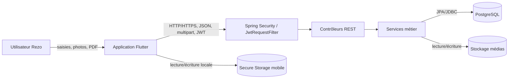

# Architecture de sécurité de Rezo

Ce document sert de base au diagramme d'architecture et au modèle OWASP Threat Dragon. Il sera enrichi après l'inventaire complet des flux et des contrôles.

## Périmètre

- Application mobile Flutter exécutée sur l'appareil de l'utilisateur.
- API REST Spring Boot exposée sur le réseau.
- Base de données PostgreSQL.
- Stockage local des médias et justificatifs par le backend.
- Services de matching, messagerie, offres et assistance.

## Vue logique

Cette représentation est une base documentaire. Le livrable officiel sera redessiné dans OWASP Threat Dragon avec des frontières de confiance explicites et exporté en JSON.

## Acteurs et rôles

| Rôle | Besoin métier principal | Ressources manipulées |
|---|---|---|
| `LYCEEN` | Trouver une orientation et des écoles | Profil, préférences, recommandations et justificatifs |
| `ETUDIANT` | Trouver stages, emplois et contacts | Profil, compétences, offres, messages et swipes |
| `ENTREPRISE` | Publier des offres et rechercher des profils | Fiche entreprise, offres, médias, candidats et messages |
| `ECOLE` | Présenter ses formations et recruter | Fiche école, programmes, candidats et messages |
| `ADMIN` | Administrer les référentiels et comptes | Utilisateurs, packs, écoles, entreprises et métriques |

## Données sensibles

| Donnée | Localisation principale | Propriété de sécurité prioritaire |
|---|---|---|
| Email, nom, prénom et téléphone | PostgreSQL | Confidentialité et intégrité |
| Empreinte BCrypt du mot de passe | PostgreSQL | Confidentialité et intégrité |
| Jetons d'accès et de rafraîchissement | Secure Storage mobile et PostgreSQL | Confidentialité, intégrité et révocation |
| Profil, compétences et objectifs | PostgreSQL | Confidentialité et exactitude |
| Messages privés | PostgreSQL | Confidentialité, autorisation objet et non-répudiation |
| Photos et justificatifs PDF | Stockage du backend | Confidentialité, intégrité et contrôle du contenu |
| Swipes et préférences de matching | PostgreSQL | Confidentialité et transparence du traitement |
| Offres et fiches école/entreprise | PostgreSQL et stockage médias | Intégrité et contrôle de propriété |

## Frontières de confiance initiales

1. Utilisateur vers application mobile : saisies et fichiers non fiables.
2. Appareil mobile vers API : frontière réseau publique, authentification JWT requise selon la route.
3. API vers PostgreSQL : frontière entre logique applicative et données persistantes.
4. API vers stockage de fichiers : frontière d'écriture et de lecture des médias téléversés.

Le téléphone et l'application Flutter doivent être considérés comme non fiables par l'API : un attaquant peut modifier l'application, intercepter les requêtes ou appeler directement les endpoints sans passer par l'interface.

## Flux principaux à confirmer

| Source | Destination | Données | Protection attendue |
|---|---|---|---|
| Utilisateur | Application Flutter | Identifiants, profil, messages, médias | Validation locale pour l'UX, stockage sécurisé des jetons |
| Application Flutter | API d'authentification | Email et mot de passe | HTTPS, limitation de débit, réponse générique |
| Application Flutter | API métier | JWT, profils, offres, messages et swipes | HTTPS, authentification, autorisation objet et validation serveur |
| API | PostgreSQL | Comptes, rôles, offres, messages et tokens | Compte BDD restreint, requêtes paramétrées, chiffrement du transport |
| API | Stockage de fichiers | Photos et justificatifs PDF | Limites de taille, contrôle du contenu, noms générés, répertoire isolé |

## Contrôles observés dans le code

- Les jetons mobiles sont stockés par `flutter_secure_storage` et non dans les préférences ordinaires.
- Spring Security utilise une politique sans session et un filtre JWT.
- Les mots de passe sont représentés uniquement par une empreinte `passwordHash` dans l'entité utilisateur.
- Les secrets PostgreSQL et JWT sont injectés depuis des variables d'environnement.
- Les contrôleurs privés obtiennent l'identité authentifiée via `Principal`.
- Des tests de propriété existent notamment pour les messages et les offres.

Ces observations ne prouvent pas à elles seules l'absence de vulnérabilité. L'analyse manuelle doit vérifier chaque chemin métier, notamment les routes publiques, l'autorisation objet, la validation des DTO, les uploads et les fonctions d'administration.

## Points d'attention pour STRIDE

| Élément | Catégories prioritaires | Scénario à analyser |
|---|---|---|
| Connexion et refresh JWT | Spoofing, DoS | Brute force, vol ou rejeu d'un jeton |
| Requêtes mobile vers API | Tampering | Modification des identifiants, rôles, packs ou objets métier |
| Messages et offres | Repudiation, Information Disclosure | Action contestée ou accès à une ressource d'un autre utilisateur |
| Uploads photo/PDF | Tampering, DoS | Faux type de fichier, contenu actif ou fichier volumineux |
| Matching et recommandations | Information Disclosure, Tampering | Exposition de profils ou manipulation des préférences |
| Administration et KPI | Elevation of Privilege | Appel d'une fonction privilégiée par un compte ordinaire |
| PostgreSQL | Information Disclosure, Tampering | Exfiltration ou altération de données persistées |
| API publique | DoS | Requêtes coûteuses ou répétées sans limitation de débit |

## Composants Threat Dragon prévus

- Acteur : utilisateur Rezo.
- Acteur externe : attaquant réseau ou appareil compromis.
- Processus : application Flutter.
- Processus : API Spring Boot / Spring Security.
- Processus : services métier de matching et messagerie.
- Data store : stockage sécurisé mobile des jetons.
- Data store : PostgreSQL.
- Data store : stockage des médias.

## Construction attendue dans Threat Dragon

1. Dessiner une zone hostile contenant l'utilisateur et l'appareil mobile.
2. Dessiner une frontière « réseau public » autour du flux mobile/API.
3. Dessiner une zone backend contrôlée contenant Spring Security, les contrôleurs et les services.
4. Dessiner une zone données restreinte contenant PostgreSQL et le stockage de fichiers.
5. Ajouter et nommer tous les flux du tableau précédent.
6. Associer les menaces STRIDE aux composants et aux franchissements de frontières.
7. Exporter le résultat à la racine sous `threat-model.json` et enregistrer une capture dans `screenshots/dfd-threat-dragon.png`.
